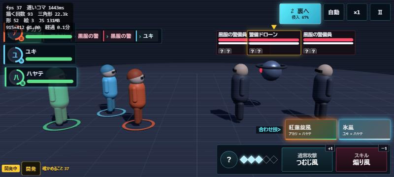
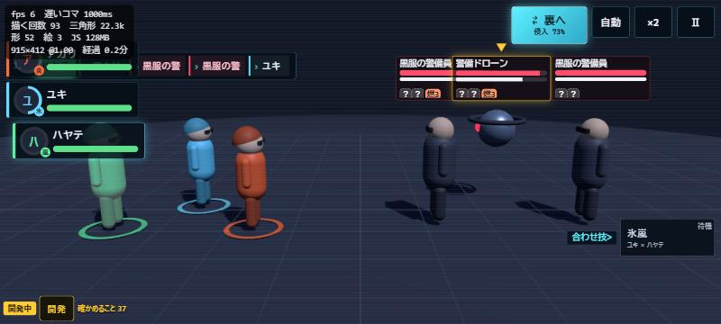
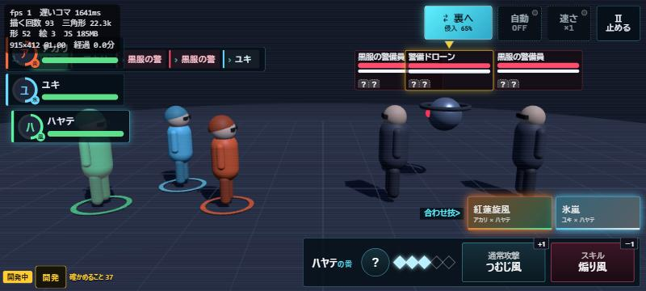
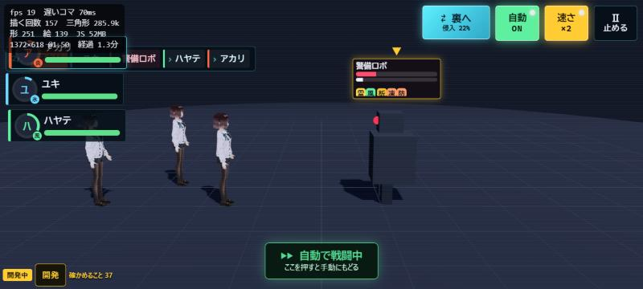

# 戦いの画面：固まる不具合・自動のボタン・押しやすさ（2026-11-23）

S26 での報告「戦っていたら画面が動かなくなった／自動ボタンが押されているかが分かりにくい／UIをもっと使いやすく」への対応。

## 1. 戦いの途中で固まる

### 原因（再現できた）

開発用の画面で、自動・速さ・表と裏の行き来・合わせ技・コマンドをでたらめに押し続ける試しをしたところ、**群れが入れかわるところ**で止まった。

- 戦いの計算は先に済み、画面はその出来事を順に見せる。合わせ技や必殺技で1つめの群れを倒しきると、見せている途中で計算の方はもう2つめの群れに入れかわっている。
- 画面は、出来事の相手（前の群れの敵）を探して見つからず、エラーになっていた。
- エラーで戦いの流れが止まり、ボタンを押しても何も起きなくなった。これが「画面が動かなくなった」。
- 自動・倍速で合わせ技がよく撃たれるほど起きやすかった。

### 直したこと

- 画面で見せるときは、前の群れの敵と裏のシンも探せるようにした。見つからない出来事は見せずに先へ進む。
- 念のため、ほかの場所でエラーが出ても固まらないようにした。
  - 戦いの流れでエラーが出たら、記録して続ける。何度も続くときは戦いを中断して拠点へもどす（負けには数えない）。
  - 毎コマの描画でエラーが出ても、次のコマは動く。
  - 動きの途中でエラーが出ても、ほかの動きや待ちは止まらない。
- 直したあと、同じでたらめ押しを戦い9回ぶん続けて、エラーも止まりも出なかった。
- 計算の方も、でたらめな順で押す試しを全部の戦い×12回ずつ足した（テスト）。

### 手がかりを残す

もし別の原因で固まっても、何が起きたかが分かるように記録を残す。

- 記録は端末の中（localStorage）だけ。どこにも送らない。
- 中身は、いつ・どこで（frame／battle／stall／gpu など）・何が起きたか。それと、そのときの戦いのようす（番・群れ・自動・速さ・裏・HP）。
- 入力待ちでも一時停止でもないのに、戦いが10秒進まないときも「stall」として残す。
- 3D の描画が端末に打ち切られたとき（メモリ不足など）も「gpu」として残す。
- ふつうに遊んでいるときは「問題が起きました（記録しました）」と小さく出る。
- 見るときは、URL に `?dev` を付けて開き、「開発」→「道具」の、いちばん上の「不具合の記録」を開く。

## 2. 自動のボタンが ON か OFF か

前は ON にしても見た目が変わらなかった。新しい見た目の決まりで、ON の色が消されていたため。

| 前（OFF） | 前（ON・×2） |
|---|---|
|  |  |

| 後（OFF） | 後（ON・×2） |
|---|---|
|  |  |

切りかえボタン（自動・速さ）を同じ形にそろえた。

- 上に名前、下に今の状態（「OFF／ON」「×1／×2／×3」）。
- OFF のとき：うすい色で、ふちは点線。
- ON のとき：自動は緑、速さは金色でぬりつぶし、光る。右上の小さな灯りが点滅する。
- 一時停止も同じ大きさにした（「Ⅱ 止める」）。
- 自動のあいだは、下のまん中に「▶▶ 自動で戦闘中」の帯が出る。帯を押すと手動にもどる。親指の届くところで切れる。

## 3. 押しやすさ・分かりやすさ（戦いの画面）

S26 の横画面で、親指で押すことを考えた。

- 右上のボタンを大きくし（高さ 50）、間を広げた。
- コマンドの左に「〇〇の番」を出す。だれのコマンドを選んでいるかが分かる。
- 自動のあいだは、合わせ技の列を出さない。自動で撃つので、押せないボタンを見せないため。
- どのボタンも、押すと少し縮んで明るくなる。押せたかが分かる。
- 結果の画面や拠点では「自動で戦闘中」の帯を出さない。

置き方は、今までどおり、ハッキング画面風の自分たちの形のまま。スターレイルの置き方は写していない。

S26 で確かめることは、`docs/check-list.md` の「戦いの画面（固まる・自動のボタン・押しやすさ）」に足した。
