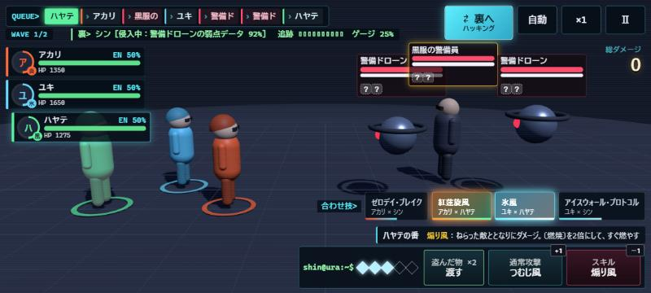
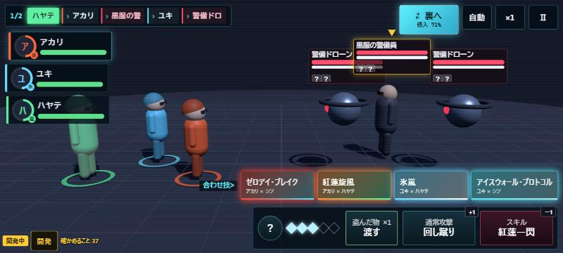
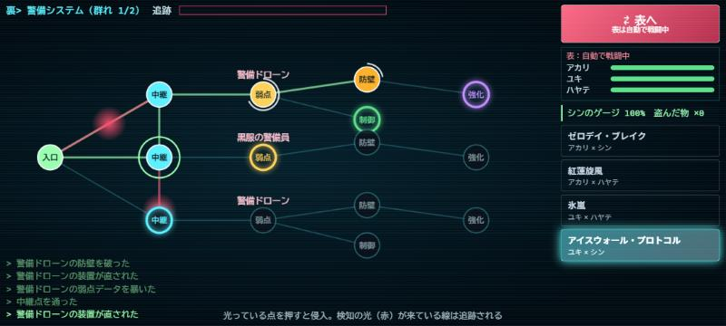
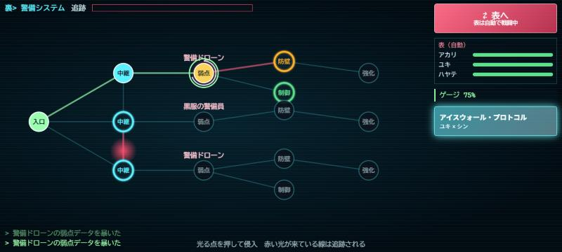

# 戦いの画面を見やすくした（2026-11-23）

ユーザーの声：「戦闘画面がごちゃごちゃしすぎて見にくい」。
考え方：いつも出すのは「次にだれが動くか・味方の体力とゲージ・押せるコマンド・敵の体力と弱点」だけ。細かい数字や説明は押したときだけ。ハッキング画面風の見た目は保つ。

## 表

| 前 | 後 |
|---|---|
|  |  |

減らしたもの：
- 上の「裏のようす」の1行 → 「⇄ 裏へ」のボタンの中に「侵入 71%」と短く（危ないときはボタンが赤く光る）
- 右上の総ダメージ → 出さない（勝ったあとの画面には出る）
- 「WAVE 1/2」の札 → 順番の頭に「1/2」
- 順番 → 7人 → 5人、1つずつ大きく
- 味方の「HP 1260」「EN 50%」の数字 → 出さない（体力のバーと、顔のまわりの輪で分かる）
- 技の説明の行と「shin@ura:~$」 → 出さない。説明は「？」を押したときだけ
- 合わせ技の列 → 撃てるものだけ出す（撃てるものがなければ列ごと出ない）
- ボタンは大きく（高さ 56px）、間をあけた

（「後」の写真は、確かめのため合わせ技4つを全部撃てる状態にしてある。ふだんは撃てるものだけ出る）

## 裏

| 前 | 後 |
|---|---|
|  |  |

減らしたもの：
- 右の合わせ技 → 撃てるものだけ
- 左下の出来事の文字 → 5行 → 2行
- 上の題の「（群れ 1/2）」、右の「シンのゲージ」「盗んだ物 ×0」 → 短く（盗んだ物は、あるときだけ）
- 下の説明を短く
